<p align="center">
  
</p>

- <a href="docs/vsp-format.md"></a>&nbsp;&nbsp;[VSP Format & Compiler](docs/vsp-format.md) — `.vsp` Graph v2 schema, 16 `.vsl` `@hook` stages, `vsp-compiler`, `vsp-cli`, and `blake3` cache
- <a href="docs/capabilities-and-optimization.md"></a>&nbsp;&nbsp;[Engine Capabilities & Optimizations](docs/capabilities-and-optimization.md) — Render Tiers 0–3, DAG render graph, BLAS/TLAS, SHaRC, ReSTIR DI, SVGF/NRD, vendor SDKs, and runtime optimizations
- <a href="docs/builtin-shaders.md"></a>&nbsp;&nbsp;[Built-In Shader Packs](docs/builtin-shaders.md) — Sunlit Vanilla and Obsidian Showcase specifications, settings, presets, and pack lifecycle
- <a href="CREDITS.md"></a>&nbsp;&nbsp;[Credits & Notices](CREDITS.md) — Radiante architectural lineage and third-party attributions
- <a href="AGENTS.md"></a>&nbsp;&nbsp;[Contributor & Agent Rules](AGENTS.md) — clean-room boundaries, `TASTE.md`, ABI invariants, and build checks

> **Version:** `0.2.0-beta.2` (Fabric-only). Targets **Minecraft: Java Edition 26.3** (`~26.3`) on Mojang's **RenderPearl** Vulkan backend. Requires **Pyroclast** (`vulkanturbo >=0.1.0-alpha.1`).

**Hyaloclast** (`vulkanshaders` / `IGNIS`) is a Vulkan 1.3+ shader pack, hardware ray-tracing, path-tracing, and frame-generation engine. The native rendering core is written in Rust 2024 (`cdylib`) and bound to the Fabric client through Java 25 Foreign Function & Memory (FFM).

## Supported Hardware & Platforms

| Vendor / Platform | Hardware | Minimum Driver | Supported Tiers & Features |
| :--- | :--- | :--- | :--- |
| **NVIDIA** | Turing (RTX 20), Ampere (RTX 30), Ada Lovelace (RTX 40), Blackwell (RTX 50); GTX 16 for Tiers 0–1 | Vulkan 1.3+ (Game Ready 555+ / Linux 550+) | Tiers 0–3, `VK_KHR_ray_query`, `VK_KHR_ray_tracing_pipeline`, SER & Opacity Micromaps (Ada+), optional DLSS SR/RR/FG, NRD, Reflex |
| **AMD** | RDNA 2 (RX 6000), RDNA 3 (RX 7000), RDNA 4 (RX 9000); Vega/RDNA 1 for Tiers 0–1 | Vulkan 1.3+ (Adrenalin 24.x+ / Mesa RADV 24.1+) | Tiers 0–3 (`VK_KHR_ray_query` / RT pipeline on RDNA 2+), optional AMD FSR 3 |
| **Intel** | Arc Alchemist (A-series), Arc Battlemage (B-series); Xe iGPU for Tiers 0–1 | Vulkan 1.3+ (Intel Graphics 31.0.101+ / Mesa ANV 24.1+) | Tiers 0–3 on Arc discrete GPUs, optional Intel XeSS |
| **macOS (Apple Silicon)** | M1 / M2 / M3 / M4 via `macos-aarch64` native library | macOS 14+ with Vulkan 1.3 MoltenVK | **Tiers 0–1 only** (raster G-Buffer and compute GI). Tiers 2–3 are gated when MoltenVK lacks `VK_KHR_ray_tracing_pipeline` / `VK_KHR_acceleration_structure`. |

Prebuilt native libraries are packaged for `linux-x86-64`, `linux-aarch64`, `win32-x86-64`, and `macos-aarch64` under `natives/<platform>/` with SHA-256 checksums (`natives/natives.sha256`) verified on extraction.

## Installation

1. Install **Fabric Loader `0.20.1+`** for **Minecraft `26.3`** on **Java 25**.
2. Place both **`vulkanshaders-0.2.0-beta.2.jar`** (fat JAR or platform-specific JAR) and **Pyroclast (`vulkanturbo-0.1.0-alpha.1.jar`+)** into `<gameDir>/mods/`. `fabric-language-kotlin` (`1.14.2+kotlin.2.4.21`), `fabric-resource-loader-v1`, and `fabric-api-base` are bundled via Jar-in-Jar.
3. Optional companion mods:
   - **Distant Horizons** (`>=3.0.0`) — detected at runtime via reflection for 3-MRT LOD G-Buffer rendering (Tiers 0–2) and LOD BLAS ray tracing (Tiers 2–3).
   - **Mod Menu** — quick access to Hyaloclast settings.
4. Incompatible mods (`breaks`/`conflicts` in `fabric.mod.json`): `iris`, `oculus`, `vulkanmod`, `optifabric`, `canvas`.

## Controls, F3 HUD & GPU Profiler

- **Keybinds** (*Options -> Controls -> Key Binds -> Hyaloclast*):
  - `K` — Toggle shaders on/off.
  - `R` — Hot-reload the active `.vsp` pack in-world.
  - `O` — Open the active pack settings screen (or the Shader Packs screen).
- **F3 Debug Overlay** (`showF3DebugInfo`): Displays active pack, Render Tier, upscaler and render scale, FrameGen mode, `BLAS/TLAS` counts, and Vulkan VRAM usage/budget.
- **GPU Pass Profiler** (`enableGpuProfiler`): Non-blocking Vulkan timestamp query breakdown (`VkQueryPool`, 3 frames-in-flight, up to 64 passes) rendered in the F3 overlay as `[Hyaloclast GPU] Total: X.XX ms (...)`.

## Optional Proprietary Vendor SDKs

Hyaloclast loads optional upscaler, denoiser, and frame-generation libraries dynamically via `libloading` from `<gameDir>/natives/` and OS system library paths. No proprietary binaries are bundled in the mod JAR.

| Vendor | Libraries | Probed Filenames |
| :--- | :--- | :--- |
| **NVIDIA** | NGX Core, DLSS SR / RR / FG, NRD | `_nvngx.dll` / `libnvidia-ngx.so.1`, `nvngx_dlss.dll` / `libnvidia-ngx-dlss.so`, `nvngx_dlssd.dll` / `libnvidia-ngx-dlssd.so`, `nvngx_dlssg.dll` / `libnvidia-ngx-dlssg.so`, `NRD.dll` / `libNRD.so` |
| **AMD** | FidelityFX FSR 3 | `amd_fidelityfx_vk.dll` / `libamd_fidelityfx_vk.so` / `libamd_fidelityfx_vk.dylib` (and `ffx_fsr3` variants) |
| **Intel** | XeSS | `libxess.dll` / `xess.dll` / `libxess.so` / `libxess.so.1` |

Open **Shader Libraries** in-game to check per-library status. Builds configured with `-Pvs.distribution=modrinth` (default) or `github` allow opt-in SHA-256-verified downloads for redistributable Windows x64 libraries (FSR 3, XeSS) from allowlisted GitHub hosts; `-Pvs.distribution=curseforge` disables external downloads and requires manual placement in `<gameDir>/natives/`.

## Building & Testing

Requires **Rust 1.88+** (Edition 2024), **JDK 25**, and **Python 3.10+** (for `dev/smoke/smoke.py`).

```sh
cargo fmt --all -- --check
cargo clippy --workspace --all-targets -- -D warnings
cargo test --workspace --locked
cargo run --locked -p vulkanshaders-sdk-bench -- verify --repo-root .
python3 dev/smoke/smoke.py --ci
cargo run --locked -p vsp-cli -- check src/main/resources/builtin-packs/hyaloclast-sunlit-vanilla.vsp --tier 3
cargo run --locked -p vsp-cli -- check src/main/resources/builtin-packs/hyaloclast-obsidian-showcase.vsp --tier 3
./gradlew test build
```

Packaging options:

```sh
./gradlew build -Pvs.distribution=modrinth                         # default fat JAR (all staged platforms)
./gradlew build -Pvs.distribution=curseforge                       # external SDK downloads disabled
./gradlew jar -Pvs.cargo=false -Pvs.nativePlatform=linux-x86-64    # per-platform JAR (linux-x86-64, linux-aarch64, win32-x86-64, macos-aarch64)
```

## Architecture Overview

| Component | Role | Key Dependencies |
| :--- | :--- | :--- |
| `crates/vulkanshaders-core` | Native `cdylib`: RenderPearl device merger, DAG `RenderGraph`, BLAS/TLAS slab allocator, OMM/SER, SHaRC, ReSTIR DI, SVGF/NRD, Reflex/FG pacing, C FFI | `ash` 0.38, `gpu-allocator` 0.28, `parking_lot`, `libloading` |
| `crates/vsp-compiler` | `pack.toml` parser, `.vsl` `@hook` preprocessor, SPIR-V 1.6 compiler, reflection & spec-constant patcher, `blake3` disk cache | `shaderc` 0.10, `naga` 30.0, `rspirv` 0.13, `blake3` |
| `crates/vsp-cli` | Standalone `vsp` CLI (`check`, `compile`, `validate`, `profile`, `init`, `migrate-help`) | `clap`, `vsp-compiler` |
| `crates/vulkanshaders-sdk-bench` | Hardware-free ABI, C header, binary export, FFI↔FFM, shader, and mixin contract verifier | `clap`, `blake3`, `libloading` |
| `src/main` (Java 25 / Kotlin) | Fabric mixins (`mixinPriority = 1100`), FFM `NativeCoreBridge`, 4-MRT G-Buffer, Pyroclast bridge, Distant Horizons bridge, GUI, F3 HUD | Java 25 FFM, Kotlin 2.4.21, Fabric Loader 0.20.1+ |

## Built-In Shader Packs

- **Sunlit Vanilla** (`hyaloclast-sunlit-vanilla.vsp`) — default gameplay-tuned pack supporting Tiers 0–3, LabPBR, HDR output, volumetric fog, and 4 presets (`low`, `medium`, `high`, `ultra`).
- **Obsidian Showcase** (`hyaloclast-obsidian-showcase.vsp`) — extends `hyaloclast-sunlit-vanilla` with showcase tuning (AgX grading, POM enabled, 3-bounce path tracing, stronger volumetric fog and godrays).

See [Built-In Shader Packs](docs/builtin-shaders.md) for the full manifest, settings, and file breakdown.

## Known Limitations

- **Fabric-only**: NeoForge is not supported.
- **macOS / MoltenVK**: Limited to Tiers 0–1 until MoltenVK exposes full `VK_KHR_ray_tracing_pipeline` and `VK_KHR_acceleration_structure`.
- **OpenGL / Sodium-only mods**: Mods requiring OpenGL or Sodium (including Voxy) are incompatible with RenderPearl Vulkan.
- **Proprietary SDKs**: DLSS, NRD, FSR 3, and XeSS binaries are not redistributed inside the mod JAR.

## License & Attributions

Licensed under **GPL-3.0-only** ([`LICENSE`](LICENSE)) with **Section 7 Additional Permissions** ([`LICENSE-EXCEPTION.md`](LICENSE-EXCEPTION.md)) permitting dynamic linking with optional proprietary upscaler/denoiser/frame-generation SDKs and independent licensing of `.vsp` shader packs.

See [`CREDITS.md`](CREDITS.md) and [`THIRD_PARTY_NOTICES.txt`](THIRD_PARTY_NOTICES.txt) for lineage and third-party notices.
